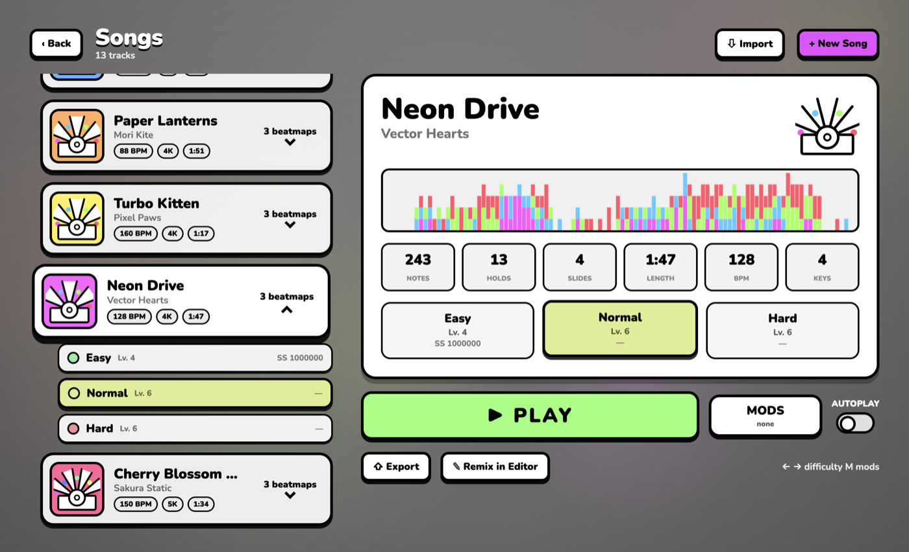
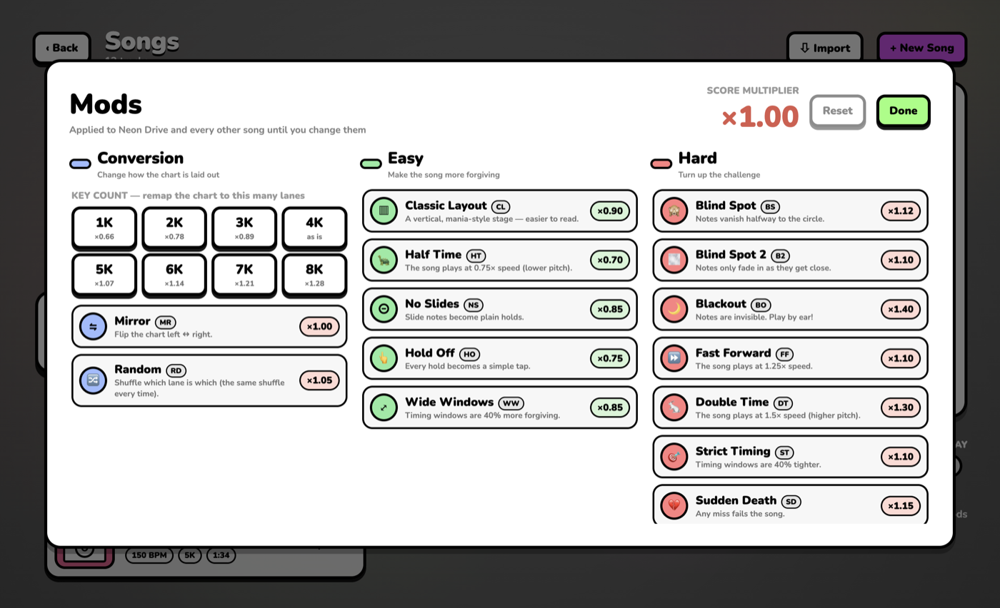
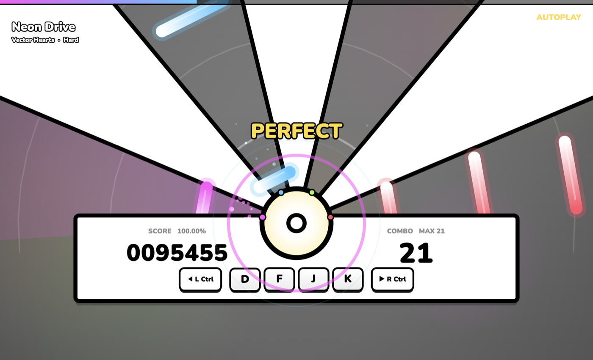
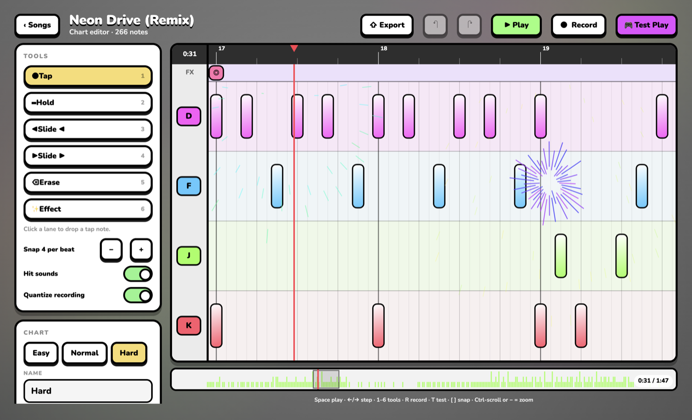

# ManiDim

A fan-shaped rhythm game.(Made with Ai) Notes fly down a fan of lanes toward a hit circle, and you press the key bound to each lane as they arrive. It plays a little like DDR with rebindable keys and an osu!mania-style chart system, plus a third note type (slides) that makes you use two hands in a different way.



| Version | Platform | Built with | Download |
|---|---|---|---|
| **Mac 1.0** | macOS 14+ (Apple silicon build) | Swift, SwiftUI, AVAudioEngine | [Releases](../../releases/latest) → `ManiDim-mac.zip` |
| **Windows 1.0** | Windows 10/11 (x64 and arm64) | Electron, Canvas 2D, Web Audio | [Releases](../../releases/latest) → `ManiDim-Portable-x64.exe` / `ManiDim-Setup-x64.exe` |

Both versions share the same game design, the same `.madim` song package and the same text chart format, so songs and charts move between them.

## Gameplay

- **Tap**: press the lane's key as the note reaches the circle.
- **Hold**: press on the head and keep the key down until the tail arrives.
- **Slide**: while holding a slide note, tap a slide key (⌘ left / ⌘ right on Mac, Left / Right Ctrl on Windows) when its arrow arrives. The held note moves one lane in that direction.
- Lane keys are rebindable per lane count (1–8 keys), including the slide keys.
- Lanes extend off-screen forever, so notes spawn beyond the window edge.
- Judgments: Perfect ±45 ms, Great ±90 ms, Good ±135 ms. Score is out of 1,000,000.
- Anti-mash rule: pressing more keys than there are notes due in a short window counts as a miss.

## Features

- **Home, song select, results**: animated menus, attract-mode autoplay, per-chart best scores and grades (SS to D), timing histogram.
- **12 built-in songs** (synthesised at first launch), several difficulties each, plus an interactive tutorial. The tutorial slows the song to a stop and waits for you to press the right key before introducing hold and slide notes.
- **Your own songs**: import any audio file or a blank metronome. Tempo is detected and a starter chart can be auto-generated.
- **Chart editor**: beat-snapped timeline, Tap / Hold / Slide / Erase / Effect tools, live Record mode (play along to chart), undo/redo, test-play from the playhead, multiple charts per song, remix built-in songs.
- **Effects**: sparkles, flash, shake, pulse, fireworks, lasers and colour washes, placed in the editor's FX row and played back in-game.
- **Mods** with stacking score multipliers, in three categories:
  - *Conversion*: 1K–8K (remap the chart onto that many lanes), Mirror, Random.
  - *Easy*: Classic Layout, Half Time, No Slides, Hold Off, Wide Windows.
  - *Hard*: Blind Spot (notes vanish halfway), Blind Spot 2 (notes fade in), Blackout, Fast Forward, Double Time, Strict Timing, Sudden Death, Perfect Only, Double Notes.
- **Styles and backgrounds**: Original, High Contrast and Classic (vertical stage) skins, preset/colour/own-image backgrounds.
- **Audio offset** setting with tap calibration.
- **osu!mania import (new)**: Songs → Import accepts `.osz` sets and `.osu` files.
  - Every mania difficulty with the same audio becomes a chart, with its own key count. A set with 4K, 5K and 7K versions imports as one song.
  - Hold notes keep their length, and BPM and offset are read from the beatmap.
  - osu!standard maps are not supported, and hitsounds are ignored.
  - Imported songs carry an **OSZ IMPORTED** label, and each song card has a **N beatmaps** dropdown listing its difficulties.
- **`.madim` export/import**: a renamed zip with the audio and a compact text chart. See [CHART_FORMAT.md](CHART_FORMAT.md).







## Install

### Windows

Download from [Releases](../../releases/latest):

- **`ManiDim-Portable-x64.exe`**: a single file, nothing to install. It unpacks to a temp folder on every launch, so start-up takes a few seconds.
- **`ManiDim-Setup-x64.exe`**: a one-click installer with Start menu and desktop shortcuts.
- **`ManiDim-win32-x64.zip`** / **`ManiDim-win32-arm64.zip`**: a plain folder. Extract the whole zip and run `ManiDim.exe` from inside it (it needs the files next to it).

The apps are unsigned, so Windows SmartScreen will warn: click **More info → Run anyway**. Default keys are D F J K for four lanes, with Left / Right Ctrl for slides. Everything is rebindable in Settings. F11 toggles fullscreen. If the game feels early or late, use Settings → Gameplay → Calibrate.

### Mac

Download `ManiDim-mac.zip` from Releases, unzip it and move `ManiDim.app` to Applications. The app is unsigned: right-click it → **Open** the first time. Slide keys default to ⌘ left / ⌘ right. The Key tester in Settings → Controls shows whether modifier keys register.

## Build from source

### Mac (needs Xcode or the Command Line Tools)

```bash
cd mac
./build.sh && open ManiDim.app
swift build -c release && .build/release/ManiDim --selftest   # engine tests with a bot
```

### Windows version (needs Node 20+; builds Windows binaries from any OS)

```bash
cd windows
npm install
npm test                 # logic tests: engine, mods, chart text, osu import, bots on every song
npm run build && npx electron .     # run it locally
node package-win.mjs     # folder builds + zips (x64 and arm64) in release/
npx electron-builder --win --x64 --prepackaged release/ManiDim-win32-x64 --config builder.json   # single-file exe + installer
```

`package-win.mjs` embeds the icon with a pure-JS resource editor, so Wine isn't required. The icon frames are generated from `mac/Resources/icon1024.png` (see `windows/make-ico.mjs`).

## Repository layout

```
mac/        Swift package (SwiftUI app, engine, audio, editor, importers)
windows/    Electron port (JS engine, renderer, UI, tests, packaging scripts)
docs/       Screenshots
CHART_FORMAT.md   the compact text chart format (.mdc)
```

## Known limitations

- The Windows build was not tested on real Windows hardware beyond a VM; in a VM with weak graphics, expect lag.
- Built-in song audio is synthesised from a random generator, so it sounds slightly different between Mac and Windows (charts are identical).
- Imported osu sets with mixed key counts can be played but not edited in the editor.
- No code signing or auto-update.

## Credits

UI font: [Nunito](https://fonts.google.com/specimen/Nunito) (SIL Open Font License), bundled via `@fontsource/nunito`. osu! is a trademark of ppy Pty Ltd. This project is not affiliated with it; it only reads the `.osu` / `.osz` file formats.
